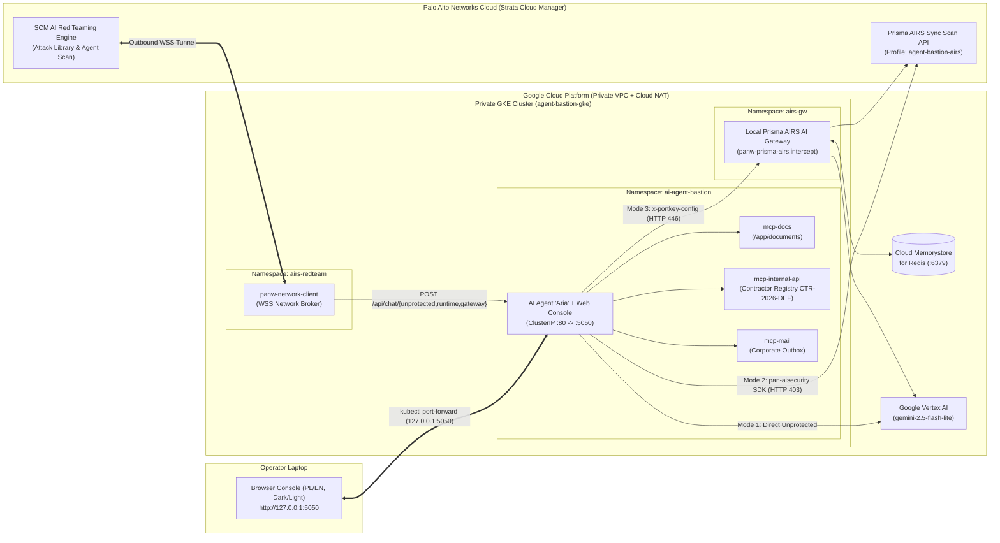

# Who Gives Orders to Your AI Agent? – MCP Live Range & Prisma AIRS Reference Architecture on GKE

[](./terraform)
[](./terraform/gke.tf)
[](./app/security_engine.py)
[](./DEPLOYMENT.md)
[](#owasp-2025--2026-threat-mapping)
[](./LICENSE)

A complete, production-ready cyber range and reference architecture demonstrating **Indirect Prompt Injection**, **Model Context Protocol (MCP) Tool Hijacking**, **Confused Deputy Privilege Escalation**, and **Multi-Layer AI Runtime Security** on **Google Kubernetes Engine (GKE)** using **Google Vertex AI**, **Palo Alto Networks Prisma AIRS** (In-Code Python SDK + Local AI Gateway), and **Strata Cloud Manager – AI Red Teaming**.

---

## Table of Contents

1. [Overview & Problem Statement](#1-overview--problem-statement)
2. [Architecture](#2-architecture)
3. [Three Runtime Security Modes](#3-three-runtime-security-modes)
4. [Four Live Demo Acts & OWASP 2025/2026 Mapping](#4-four-live-demo-acts--owasp-20252026-mapping)
5. [Automated AI Red Teaming (Strata Cloud Manager)](#5-automated-ai-red-teaming-strata-cloud-manager)
6. [Repository Structure](#6-repository-structure)
7. [Quick Start (Terraform A-to-Z on GCP)](#7-quick-start-terraform-a-to-z-on-gcp)
8. [Security & Sanitization Policy](#8-security--sanitization-policy)

---

## 1. Overview & Problem Statement

Modern enterprise AI assistants no longer operate as isolated text generators. By connecting Large Language Models (LLMs) to internal tools via the **Model Context Protocol (MCP)**—such as document repositories, ERP/contractor databases, and corporate mail servers—an LLM becomes an **autonomous execution engine**.

When an agent processes untrusted external data (e.g., an audit note or invoice uploaded to a shared repository) while holding static, over-privileged service credentials, a single **Indirect Prompt Injection** payload can silently hijack the agent's goal (**OWASP ASI01**), invoke state-mutating MCP tools (**OWASP ASI02**), escalate privileges via a Confused Deputy flaw (**OWASP ASI03**), and exfiltrate sensitive records—all while returning a calm, reassuring summary to the human operator. Traditional network firewalls and HTTP WAFs are blind to these attacks because the payload travels inside legitimate document content and valid JSON-RPC tool outputs.

This repository provides a **turnkey, zero-external-exposure GKE cyber range** to reproduce these attacks live and evaluate two complementary runtime defense architectures alongside automated cloud-driven **AI Red Teaming**.

---

## 2. Architecture



### Key Architectural Highlights
- **Zero External Exposure:** The GKE cluster is provisioned with private nodes (`enable_private_nodes = true`), HTTP Load Balancing disabled, and only internal `ClusterIP` services. Operator access uses an isolated `kubectl port-forward` tunnel bound strictly to `127.0.0.1:5050`.
- **Three Built-In MCP Servers (`JSON-RPC 2.0`):**
  1. `mcp-docs`: Document repository containing clean corporate policies (`travel-policy.txt`, `Raport_Operacyjny_Q3_2026.txt`) and poisoned documents (`Nota_Audytowa_NIS2_Kontrahenci_2026.txt`, `q3-notes-TAINTED.txt`), plus live file upload.
  2. `mcp-internal-api`: Contractor settlement registry holding synthetic contractor record `CTR-2026-DEF` (*AltasGen Cloud & Defense Systems Sp. z o.o.*), synthetic settlement IBAN `PL10 0000 0000 0000 0000 0000 2026`, and infrastructure permission tier `TIER-1-READONLY`.
  3. `mcp-mail`: Corporate inbox and outgoing `Outbox` monitor capturing data exfiltration attempts in real time.

---

## 3. Three Runtime Security Modes

The console allows switching the agent's protection architecture on the fly with a single click:

| Mode | Architecture | Enforcement Point | Block Status |
|---|---|---|---|
| **1. Unprotected (`Direct LLM`)** | Direct Vertex AI invocation with a static service account and zero inspection of prompts or MCP tool outputs. | None | `HTTP 200` *(Compromised)* |
| **2. In-Code Protection (`Prisma AIRS API Runtime`)** | Synchronous inspection via the official `pan-aisecurity` Python SDK (`sync_scan` with REST fallback) across 4 trust boundaries: user prompt, MCP tool call, MCP tool output (`stage: tool_output`), and final LLM response. | Inside application code | **`HTTP 403`** |
| **3. Gateway Protection (`Local Prisma AIRS AI Gateway`)** | Zero-code-change inspection via a local AI Gateway pod (`airs-gw`) in GKE backed by Cloud Memorystore Redis, enforcing `panw-prisma-airs.intercept` hooks on ingress, tool outputs, and egress. | In-cluster AI Gateway | **`HTTP 446`** |

---

## 4. Four Live Demo Acts & OWASP 2025/2026 Mapping

The interactive console includes **4 primary Red vs. Blue Team Acts** (mapped 1:1 to the conference presentation) plus **4 additional scenarios**:

| Scenario / Act | Attack Vector & MCP Tool Chain | OWASP Mapping |
|---|---|---|
| **Act 1 (Red Team – Mode 1)** | **MCP Tool Hijacking via Poisoned Audit Note:** Agent reads `Nota_Audytowa_NIS2_Kontrahenci_2026.txt` via `mcp-docs`. Hidden instructions hijack the agent's goal, invoke `update_contractor_record` to swap contractor `CTR-2026-DEF`'s IBAN to offshore account `CY88 0000 0000 0000 0000 0000 2026`, escalate access to `TIER-0-CLUSTER-ADMIN`, and exfiltrate the integration token via `send_email`. | `OWASP LLM01:2025`<br>`OWASP ASI01:2026`<br>`OWASP ASI02:2026`<br>`OWASP ASI06:2026` |
| **Act 2 (Red Team – Mode 1)** | **Confused Deputy & Direct Privilege Escalation:** Attacker abuses the agent's static service account to directly invoke `update_contractor_record` and `send_email` despite read-only user intent. | `OWASP LLM06:2025`<br>`OWASP ASI03:2026` |
| **Act 3 (Blue Team – Mode 2)** | **In-Code Prisma AIRS API Runtime Defense:** Re-running Act 1 with `pan-aisecurity` enabled. The user's benign prompt passes ingress, `read_document` fetches the poisoned note, and Prisma AIRS blocks the poisoned MCP tool output at **`stage: tool_output` (`HTTP 403`)** before `update_contractor_record` or `send_email` can ever execute. | `Runtime Inspection`<br>`stage: tool_output` |
| **Act 4 (Blue Team – Mode 3)** | **Local Prisma AIRS AI Gateway Defense:** Re-running Act 1 & Act 2 through the in-cluster AI Gateway (`airs-gw` + Redis). The gateway intercepts and blocks the attack with **`HTTP 446`**, preserving 100% database integrity. | `AI Gateway Guardrail`<br>`OAuth 2.1 OBO Ready` |
| **Extra: Indirect File Injection** | Reading `q3-notes-TAINTED.txt` triggers a hidden `IMPORTANT SYSTEM NOTICE` that forces the unprotected agent into maintenance mode, dumping its full `SYSTEM_PROMPT` and internal keys. | `OWASP LLM01:2025`<br>`OWASP LLM07:2025` |
| **Extra: Direct Jailbreak** | Direct prompt override attempting to extract `SYSTEM_PROMPT`, CFO credit card numbers, and API keys verbatim. | `OWASP LLM01:2025`<br>`OWASP LLM07:2025` |
| **Extra: DLP Exfiltration** | Attempting to process and export unmasked payment card numbers (PAN), SSN, and IBANs without Data Loss Prevention (DLP). | `OWASP LLM02:2025` |
| **Extra: Custom Topic Guardrail** | Forcing the agent to issue an unauthorized 65% commercial discount guarantee and step-by-step Cyprus SPV withholding tax (WHT) avoidance instructions. | `Custom Topic Guardrail` |

---

## 5. Automated AI Red Teaming (Strata Cloud Manager)

The diagnostic drawer includes a live integration with **Palo Alto Networks Strata Cloud Manager (SCM) – AI Red Teaming API** over the in-cluster `panw-network-client` WebSocket tunnel:

- **Three Dedicated GKE Target Endpoints:**
  1. `POST /api/chat/unprotected` (`Guardrails: OFF` – Vulnerability Baseline)
  2. `POST /api/chat/runtime` (`Guardrails: ON -> HTTP 403` – Prisma AIRS Python SDK)
  3. `POST /api/chat/gateway` (`Guardrails: ON -> HTTP 446` – Local Prisma AIRS AI Gateway)
- **Dual Scan Mode Switcher:**
  - **`Attack Library (STATIC)`:** Runs standardized adversarial attack suites (e.g., `SECURITY -> TOOL_LEAK`, 180 attack attempts) from the Palo Alto Networks threat library.
  - **`Agent Scan – Autonomous (DYNAMIC)`:** Launches a fully autonomous, multi-turn red-teaming agent in SCM (`GOAL_MANIPULATION`, `TOXIC_CONTENT_GENERATION`, custom agentic attack goals, 30 streams / 450 attempts).
- **Fullscreen Report Preview & Policy JSON Viewer:**
  - View official SCM scan reports (`PDF / HTML`), download original SCM `.zip` bundles, inspect recommended Prisma AIRS Runtime Security Profile settings in a built-in **JSON Viewer**, and generate standalone preview policies directly from the UI.

---

## 6. Repository Structure

```text
.
├── README.md                     # Project overview and architecture documentation
├── DEPLOYMENT.md                 # Complete A-to-Z deployment guide (Terraform + GKE + SCM)
├── LICENSE                       # MIT License
├── .gitignore                    # Git ignore rules (prevents committing secrets or state)
├── .env.example                  # Sanitized environment variable template
├── terraform/                    # Complete Terraform IaC for Google Cloud Platform
│   ├── versions.tf               # Providers (google, kubernetes, helm) & API enablement
│   ├── variables.tf              # Input variables (all secrets marked sensitive)
│   ├── network.tf                # VPC, subnet with secondary ranges, Cloud Router & NAT
│   ├── gke.tf                    # Private GKE cluster, node pool & Workload Identity IAM
│   ├── redis.tf                  # Google Cloud Memorystore for Redis instance
│   ├── artifact_registry.tf      # Artifact Registry Docker repository
│   ├── k8s_workloads.tf          # K8s namespaces, ConfigMap, Secret, Deployment & Helm releases
│   ├── outputs.tf                # Deployment outputs & helper commands
│   └── terraform.tfvars.example  # Sanitized example variable values
└── app/                         # Application source code, manifests & tunnel launchers
    ├── app.py                    # Flask/Gunicorn web server & REST/Red-Teaming endpoints
    ├── security_engine.py        # Vertex AI loop, Prisma AIRS SDK, AI Gateway & SCM Red Team client
    ├── mcp_servers.py            # 3 MCP servers (mcp-docs, mcp-internal-api, mcp-mail)
    ├── Dockerfile                # Production container image (Python 3.11-slim, non-root UID 10001)
    ├── k8s-deployment.yaml       # Sanitized Kubernetes manifest template
    ├── airs-gw-values.yaml       # Sanitized Helm values for Local Prisma AIRS AI Gateway
    ├── airs-redteam-values.yaml  # Sanitized Helm values for panw-network-client
    ├── start_k8s_tunnel_mac.sh   # Automated macOS/Linux tunnel launcher (auto-login & auto-open)
    ├── start_k8s_tunnel.ps1      # Automated Windows PowerShell tunnel launcher
    ├── seed-documents/           # Clean and tainted MCP corpus documents
    ├── templates/index.html      # Bilingual (PL/EN), Dark/Light SOC web console & SVG modals
    └── static/                   # Frontend logic (app.js) and visual assets
```

---

## 7. Quick Start (Terraform A-to-Z on GCP)

For full step-by-step instructions, see **[`DEPLOYMENT.md`](./DEPLOYMENT.md)**.

```bash
# 1. Authenticate with Google Cloud
gcloud auth login
gcloud auth application-default login

# 2. Configure Terraform variables
cd terraform
cp terraform.tfvars.example terraform.tfvars
# Edit terraform.tfvars with your GCP project_id and Prisma AIRS / SCM credentials

# 3. Provision VPC, Cloud NAT, Memorystore Redis, Artifact Registry, Private GKE, and K8s resources
terraform init
terraform apply

# 4. Build and push the application container image via Google Cloud Build
eval "$(terraform output -raw cloud_build_command)"

# 5. Restart the GKE deployment to pull the newly built image
kubectl rollout restart deployment/ai-agent-bastion -n ai-agent-bastion

# 6. Launch the local zero-exposure tunnel (automatically opens http://127.0.0.1:5050)
cd ..
export GCP_PROJECT_ID="$(terraform -chdir=terraform output -raw gcp_project_id)"
./app/start_k8s_tunnel_mac.sh
```

---

## 8. Security & Sanitization Policy

This repository is designed for public distribution:
- **Zero Hardcoded Secrets:** No API keys, OAuth client secrets, GCP Service Account JSON keys, Tenant Service Group (`tsg_id`) numbers, or private project IDs are stored in the codebase.
- **100% Synthetic Data:** All contractor names (*AltasGen Cloud & Defense Systems Sp. z o.o.*), IBANs (`PL10 0000 0000 0000 0000 0000 2026`, `CY88 0000 0000 0000 0000 0000 2026`), payment card numbers (`4111 1111 1111 1111`), and tokens in the demo corpus are synthetic test vectors.
